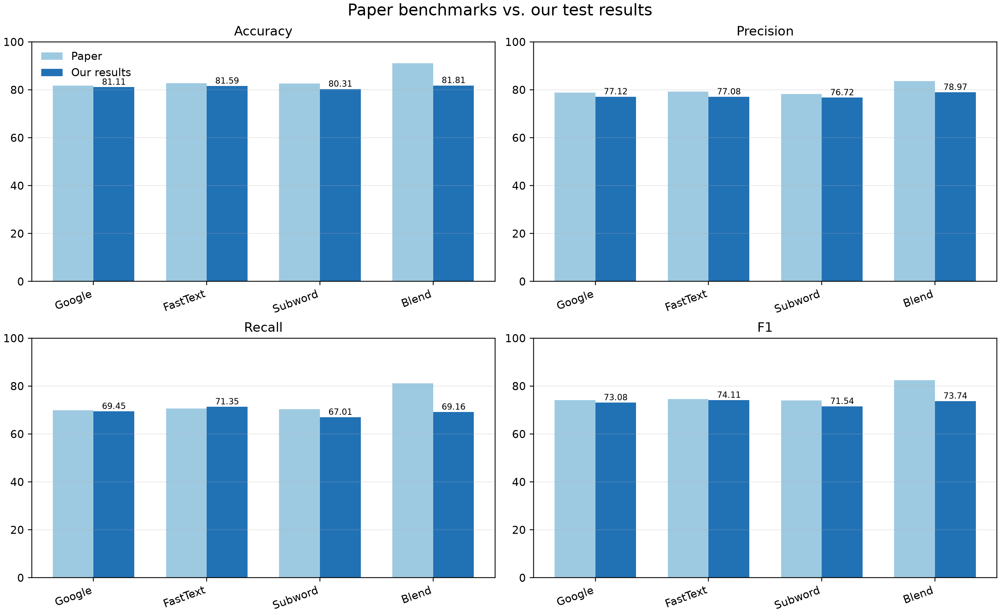
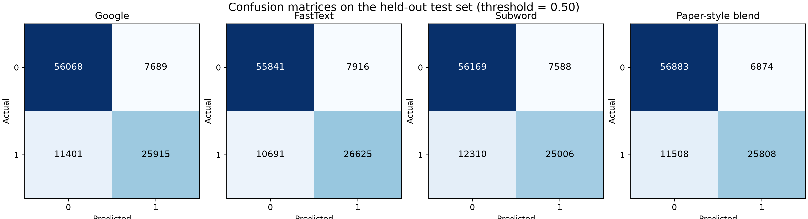
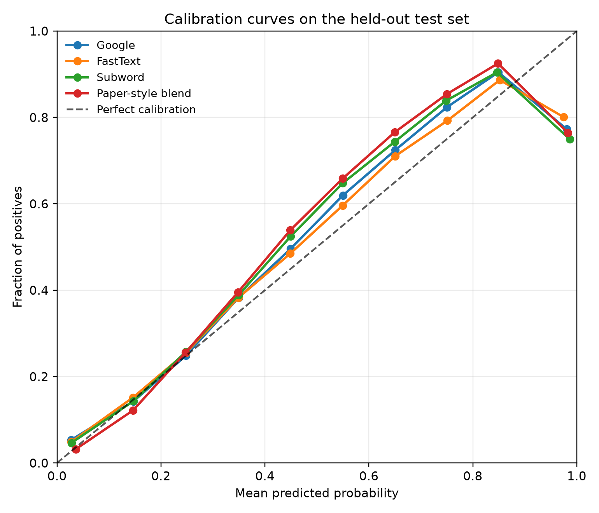
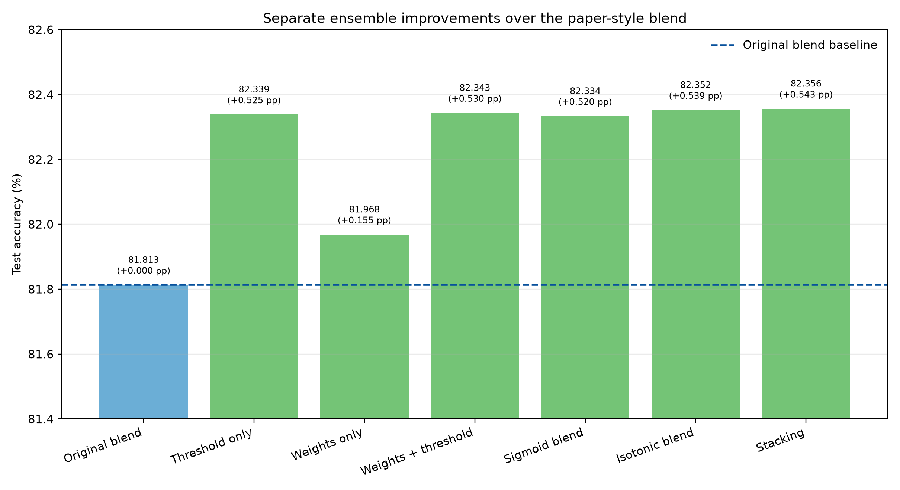

# Duplicate Question Detection with Siamese MaLSTM

[](https://www.python.org/)
[](https://www.tensorflow.org/)
[](https://scikit-learn.org/)

## Introduction

People often ask the same question using different words on websites such as
Quora. Finding these repeated questions helps users find existing answers and
reduces duplicate content. Simply matching words is not enough: two questions
can use different words and still mean the same thing, or share many words and
ask about different things.

Our project studies how deep learning can identify these question pairs. We
use a Siamese Manhattan LSTM (MaLSTM), which processes both questions with the
same network and compares their representations. The goal is to reproduce the
paper's approach, measure its performance on our test set, and explore whether
combining and tuning models improves the results.

## Project overview

This project detects whether two questions have the same meaning. For example,
“How can I learn Python?” and “What is the best way to learn Python?” may be
different sentences but ask the same thing.

It implements a **Siamese MaLSTM** model. Two questions pass through the same
LSTM network, their meaning vectors are compared, and the model returns a
similarity score from 0 to 1. Three pretrained word embeddings are tested
and their predictions are also combined in an ensemble.

## Implementation: what we have done

We implemented the project in Python using TensorFlow/Keras. The work includes
data preparation, training three models, combining their predictions, evaluating
the results, and running two additional experiments.

### 1. Prepared the question-pair dataset

We used the two question columns and the `is_duplicate` label from the dataset.
Missing questions become empty strings. We reserved 25% of the pairs for
testing and took 10% of the remaining training portion for validation. The
saved experiment contains 272,895 training pairs, 30,322 validation pairs, and
101,073 test pairs.

### 2. Converted text into model inputs

We converted text to lowercase, kept alphabetic words, removed English
stopwords, and applied Porter stemming to reduce words to simpler forms. We
then converted words into token IDs and padded or shortened each question to
20 tokens. The tokenizer learned its vocabulary from the training pairs only,
so validation and test questions did not influence the vocabulary.

### 3. Built and trained three Siamese MaLSTM models

We trained one model for each embedding source: Google News Word2Vec, FastText
Crawl, and FastText Subword. Each source represents words using 300 numbers.
Within each model, both questions pass through the same 50-unit LSTM. We
compare the resulting vectors using exponential Manhattan similarity.

We kept the pretrained embeddings fixed during training and used Adam with a
learning rate of 0.001, binary cross-entropy loss, batch size 64, and 30 epochs.
We saved the trained models and their test prediction scores for later analysis.
Some settings, including the LSTM size and optimizer, are our implementation
choices because the paper does not specify every training detail.

### 4. Combined predictions using the paper's blend

We combined the three models' scores using 33% Google News, 33% FastText, and
34% Subword. A combined score greater than 0.5 predicts a duplicate pair. This
original ensemble achieved **81.81% test accuracy**.

### 5. Tested ensemble improvements

We explored changing the decision threshold, changing the blend weights,
changing both together, sigmoid calibration, isotonic calibration, and
logistic-regression stacking. Calibration adjusts scores to better match the
observed frequency of duplicate pairs. Stacking learns how to combine the
three models' scores.

Half of the validation set was used to fit calibration or stacking models,
and the other half was used to select settings by accuracy. Validation selected
the isotonic blend, with weights 0.30/0.45/0.25 and threshold 0.48. It achieved
**82.35% test accuracy**, an improvement of **0.54 percentage points** over the
original blend. These are exploratory extensions because we had already
inspected the original test results before this tuning experiment.

### 6. Tested a different text-cleaning method

We also trained a separate FastText model with cleaning that preserves numbers,
symbols, Unicode characters, and negation words such as “not.” This experiment
reused the original data split. Its validation accuracy increased from
**81.09% to 81.79%**. We have not evaluated its test accuracy, so these validation
results are separate from the test results reported below.

### 7. Evaluated and documented the results

We recorded accuracy, precision, recall, and F1-score. We also created confusion
matrices, calibration curves, a paper-versus-our-results plot, and a separate
ensemble improvement comparison. The saved results show that we did not
reproduce the paper's reported 91.14% ensemble accuracy.

The implementation is organized into these files:

| File | What we implemented |
|---|---|
| [`main.py`](DuplicateQuestion_MaLSTM/main.py) | Commands to prepare data, train, blend, tune, display results, and verify saved predictions |
| [`model.py`](DuplicateQuestion_MaLSTM/model.py) | Text cleaning, embedding loading, Siamese MaLSTM, training, and evaluation |
| [`ensemble.py`](DuplicateQuestion_MaLSTM/ensemble.py) | The original weighted blend and validation-based ensemble tuning |
| [`summary.csv`](DuplicateQuestion_MaLSTM/results/summary.csv) | Combined results, with test and validation scores labeled separately |

## Research paper

The reference paper is [`ATML_RP.pdf`](ATML_RP.pdf). It uses a Siamese
Manhattan LSTM for duplicate-question classification and reports 91.14%
ensemble accuracy. The paper uses different experimental conditions, so that
number is a reference benchmark, not our reproduced test result.

## Dataset

The project uses [`Dataset_train.csv`](Dataset_train.csv), containing:

| Column | Meaning |
|---|---|
| `question1` | First question |
| `question2` | Second question |
| `is_duplicate` | `1` for duplicate, `0` for different |

The split is 75% training, 10% of the training portion for validation, and 25%
final test. It is stratified with seed `42`. The saved original experiment has
101,073 test pairs.

## Word embeddings

Three separate models use 300-dimensional pretrained vectors:

1. Google News Word2Vec
2. FastText Crawl
3. FastText Subword

The large embedding files are in [`embeddings/`](embeddings/).

## Model pipeline

```text
Question pairs → cleaning → tokenization/padding to 20 words
→ 300d embeddings → shared Siamese LSTM
→ Manhattan similarity → duplicate score
```

The similarity is calculated as:

```text
exp(-sum(abs(question1_vector - question2_vector)))
```

The original decision rule is: score `> 0.5` means duplicate.

### Main settings

| Setting | Value |
|---|---:|
| Maximum length | 20 tokens |
| Embedding size | 300 |
| LSTM units | 50 |
| Optimizer | Adam, learning rate 0.001 |
| Loss | Binary cross-entropy |
| Batch size | 64 |
| Epochs | 30 |
| Seed | 42 |

Text is lowercased, alphabetic words are kept, stopwords are removed, Porter
stemming is applied, and sequences are right-padded. The tokenizer is fitted
only on training data.

## Ensemble methods

The original ensemble is:

```text
33% Google + 33% FastText + 34% FastText Subword
```

The project also saves threshold tuning, weight tuning, calibrated blending
(sigmoid and isotonic), and logistic-regression stacking. The validation-
selected method is isotonic blending with weights `0.30 / 0.45 / 0.25` and
threshold `0.48`.

## Results

| Model | Accuracy | Precision | Recall | F1 |
|---|---:|---:|---:|---:|
| Google News | 81.11% | 77.12% | 69.45% | 73.08% |
| FastText | 81.59% | 77.08% | 71.35% | 74.11% |
| FastText Subword | 80.31% | 76.72% | 67.01% | 71.54% |
| Original ensemble | 81.81% | 78.97% | 69.16% | 73.74% |
| Selected isotonic blend | 82.35% | 75.88% | 76.53% | 76.20% |

Stacking reached 82.36% accuracy in the saved comparison, but isotonic
blending was selected using validation data.

## Plots

The repository-level `output` folder contains the generated comparisons:









## Repository structure

```text
prject_final/
├── README.md                           # Project documentation
├── ATML_RP.pdf                         # Reference paper
├── Dataset_train.csv                   # Dataset
├── embeddings/                         # Pretrained vectors
├── output/                             # Generated plots
└── DuplicateQuestion_MaLSTM/
    ├── main.py                          # Command-line commands
    ├── model.py                         # Cleaning, model, training, evaluation
    ├── ensemble.py                      # Blending and tuning
    ├── requirements.txt
    ├── data/quora_question_pairs.csv    # Link to dataset
    ├── embeddings/                      # Link to vectors
    └── results/
        ├── summary.csv
        ├── original/                     # Original models and predictions
        ├── tuned/                        # Tuned ensemble outputs
        └── preprocessing/               # Preserved-text validation run
```

`details.zip` files contain extra reports, plots, histories, and arrays.

## Installation

From the repository root:

```bash
python -m venv .venv
source .venv/bin/activate
pip install -r DuplicateQuestion_MaLSTM/requirements.txt
python -m nltk.downloader stopwords
```

## View and verify saved results

```bash
.venv/bin/python DuplicateQuestion_MaLSTM/main.py
.venv/bin/python DuplicateQuestion_MaLSTM/main.py --help
.venv/bin/python DuplicateQuestion_MaLSTM/main.py verify
```

The first command prints the saved result table. `verify` checks saved model
outputs and ensemble predictions without retraining or changing anything.

## Train a new experiment

Use a new directory so existing results are preserved:

```bash
.venv/bin/python DuplicateQuestion_MaLSTM/main.py prepare \
  --run-dir DuplicateQuestion_MaLSTM/results/new_run
.venv/bin/python DuplicateQuestion_MaLSTM/main.py train --model all \
  --run-dir DuplicateQuestion_MaLSTM/results/new_run
.venv/bin/python DuplicateQuestion_MaLSTM/main.py blend \
  --run-dir DuplicateQuestion_MaLSTM/results/new_run
```

For ensemble tuning:

```bash
.venv/bin/python DuplicateQuestion_MaLSTM/main.py tune \
  --output-dir DuplicateQuestion_MaLSTM/results/new_tuning
```

## Important notes

- Existing saved models and results were preserved; they were not retrained.
- The paper's 91.14% is a reference value, not our reproduced test accuracy.
- Tuned ensemble methods are exploratory validation-based extensions.
- Large embeddings are needed for new training, but not for viewing saved
  tables and plots.

## License

No license file is currently included. Add one before formally publishing or
redistributing the project.
